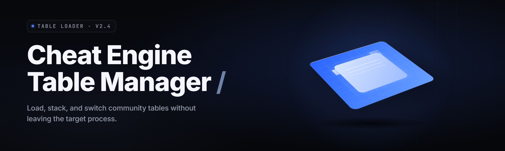

  
  
  

  

  
  
  
  

---

**One manager for every `.CT` table on your disk. Load, tag, chain, and swap tables without ever reopening Cheat Engine twice.**

I got tired of digging through `Downloads`, `Documents`, and three external drives every time I wanted to load a table for a game I'd already beaten twice. So I built the thing I wanted — a tray-resident manager that indexes every `.CT` file on the machine, tracks which process it belongs to, and pushes the load into Cheat Engine with a single keystroke. It doesn't reimplement the CE engine. It drives it.

---

## 📑 Table of Contents

- [The Problem](#-the-problem)
- [Overview](#-overview)
- [What is a Table Manager](#-what-is-a-table-manager)
- [Key Features](#-key-features)
- [Module Catalog](#-module-catalog)
  - [🔍 Indexing & Discovery](#-indexing--discovery)
  - [🧩 Table Parsing & Metadata](#-table-parsing--metadata)
  - [🎯 Process Binding & Loader](#-process-binding--loader)
  - [🔗 Chain & Preset Engine](#-chain--preset-engine)
  - [🛠️ Editing & Authoring Helpers](#️-editing--authoring-helpers)
  - [🧪 Diagnostics & Conflict Detection](#-diagnostics--conflict-detection)
- [Usage Guidelines](#-usage-guidelines)
- [All Modules Status](#-all-modules-status)
- [Compatibility / Platform Support](#-compatibility--platform-support)
- [Hotkeys](#-hotkeys)
- [Comparison](#-comparison)
- [Quick Start](#-quick-start)
- [Installation](#-installation)
- [System Requirements](#-system-requirements)
- [Known Issues](#-known-issues)
- [FAQ](#-faq)

---

## 🧨 The Problem

- You have **four hundred `.CT` files** scattered across Downloads, Desktop, an external drive, and a game folder — and no idea which one belongs to which game anymore.
- Cheat Engine's own Open dialog has no tags, no favorites, no search across drives, no recent-by-game grouping.
- Loading a table for a game that isn't running yet means you load it into the wrong process, get a wall of `???` addresses, and start over.
- Multi-table workflows (base table + pointers + a trainer overlay) mean opening CE, closing CE, opening again — every single time.
- Someone hands you a table with a broken AOB scan and you spend twenty minutes figuring out which script failed and why.
- Authoring tables means juggling a text editor and CE's memory viewer with no shared workspace.
- Nothing tracks which CE version a table was authored against, so half the tables you download silently no-op on your build.

---

## 🧭 Overview

| Category | Details |
| --- | --- |
| Product name | Cheat Engine Table Manager / Loader (Pro) |
| Type | Windows desktop `.exe` — tray-resident table indexer and loader |
| Engine dependency | Drives an existing Cheat Engine install (7.x / 8.x). Does not bundle CE. |
| Primary artifact | `.exe` |
| Config format | Portable JSON in `%APPDATA%\CETableManager\` |
| Index scope | Every fixed + removable drive, plus user-chosen folders |
| Process binding | Auto-attach via window title, exe name, or PID |
| Multi-table | Chain engine loads N tables into one CE session in order |
| Update model | Manual `.exe` swap — no auto-updater, no telemetry |

The manager's job is to be the layer Cheat Engine never built: a file-first front end. You think in terms of *tables* and *games*, not *processes* and *memory regions*. It keeps a persistent index, watches your drives for new `.CT` files, and hands the load off to CE through its command line and its Lua bridge. When CE isn't running, it launches it. When a table targets a process that isn't up yet, the manager holds the load in a queue and fires it the moment the window appears.

  

---

## 📖 What is a Table Manager

| Term | Explanation |
| --- | --- |
| `.CT` table | The XML file Cheat Engine saves — holds cheats, pointer paths, assembler scripts, and AOB scans for one game. |
| Process binding | Associating a table with a target process so the loader knows which handle to attach before pushing the table. |
| Chain | An ordered list of tables loaded into one CE session — a base table plus overlay tables, applied back to back. |
| AOB scan | Array-of-bytes pattern scan used to find an address that survives game updates; the manager surfaces its status per table. |
| Lua bridge | CE's scripting interface — the manager uses it to open tables, run scripts, and poll the cheat list. |
| Index | The on-disk database of every `.CT` file the manager has seen, keyed by path hash and tagged by game. |
| Detach-safe load | Loading a table only after the target process exists and is stable, avoiding address-0 registrations. |

Benefits of using a manager layer:

- Find any table in **under two seconds** by game, tag, or fuzzy filename.
- Never load a table into the wrong process again — binding is explicit and remembered.
- Run multi-table workflows as a single chain instead of five manual opens.
- See which tables are stale (broken AOB, dead pointer) before you waste a session on them.
- Keep authoring and playing in one window instead of three.
- Portable config — copy the folder to a new machine and your index comes with you.

---

## ⭐ Key Features

| Feature | Description | Benefit |
| --- | --- | --- |
| Drive-wide index | Recursively scans chosen roots, hashes each `.CT`, stores metadata | Every table on the machine, one list |
| Game auto-tagging | Reads table `<CheatTable>` metadata + filename heuristics to guess the game | Tables group themselves by title |
| Process binding memory | Remembers which process each table loaded into last time | One-click relaunch for repeat games |
| Chain presets | Save an ordered set of tables as a named preset | Load a 4-table setup in one keystroke |
| AOB health probe | Re-runs a table's scans against a live process and reports hit/miss | Know if a table still works before playing |
| Lua bridge loader | Opens tables through CE's own interface, not by editing files | No corruption, no manual import |
| Conflict detector | Flags two tables that write the same address with different values | Prevents silent cheat fights |
| Authoring sandbox | Side panel with the table XML, a scratch Lua console, and a diff view | Edit without leaving the app |
| Snapshot diff | Save a memory snapshot, diff it later to find changed addresses | Manual cheat hunting made faster |
| Watch folder | Auto-imports any `.CT` dropped into a designated folder | Downloaded tables show up instantly |
| Portable profile | Index + presets + tags live in one JSON file | Move machines, keep everything |
| Tray residency | Runs in the tray, global hotkey to summon the palette | Always one keypress away |

---

## 🧩 Module Catalog

### 🔍 Indexing & Discovery

**Scanner Core** — walks configured roots, dedupes by content hash, skips symlink loops.
**Watch Folder** — a single drop target; new `.CT` files are imported and tagged automatically.
**Fuzzy Search** — matches on filename, game tag, author, and internal table name at once.
**Tag Engine** — user tags stack on top of auto-tags; both are searchable.
**Recent-by-Game** — a rolling view of the last table you loaded per game.
**Drive Map** — shows every root the scanner is watching and its last scan time.
**Duplicate Finder** — flags byte-identical tables under different names.
**Bulk Import** — drag a folder of `.CT` files in and tag them in one pass.

### 🧩 Table Parsing & Metadata

**XML Reader** — parses the table's cheat entries, scripts, and pointer records.
**Metadata Extractor** — pulls author, game name, CE version, and date from table headers.
**CE Version Tag** — records which CE build a table was authored against.
**Script Inventory** — lists every assembler and Lua script inside a table.
**Pointer Path Parser** — reads pointer chains and shows their base modules.
**AOB Extractor** — pulls every AOB signature out of a table for health checks.
**Entry Tree View** — reproduces CE's cheat-list hierarchy in a read-only tree.
**Description Scraper** — surfaces the `Description` field of each entry as a preview.

### 🎯 Process Binding & Loader

**Window Scanner** — polls top-level windows to match titles against bound games.
**Exe Matcher** — binds tables by process executable name, not just title.
**PID Pinner** — manual override to attach to a specific PID.
**Queue Loader** — holds a load until the target process appears, then fires it.
**Lua Loader** — pushes the table through CE's `openProcess` + `loadTable` path.
**Launch Helper** — optionally starts the game's exe before loading.
**Attach Guard** — refuses to load if the target process is 32/64-bit mismatched.
**Detach Watcher** — detects when the game closes and marks the table as unloaded.

### 🔗 Chain & Preset Engine

**Chain Builder** — drag tables into an ordered list and save it as a preset.
**Preset Runner** — loads the whole chain in order with per-step delays.
**Conditional Steps** — a step can be skipped if a prior table's scan failed.
**Variable Handoff** — passes a value found by one table into the next via Lua globals.
**Rollback** — unloads a chain in reverse order on a single hotkey.
**Preset Import/Export** — share a preset as a single JSON file.
**Timing Control** — per-step wait so slow games finish attaching.

### 🛠️ Editing & Authoring Helpers

**XML Side Panel** — edit the raw table next to the live view.
**Lua Scratchpad** — run throwaway Lua against the attached process.
**Diff View** — compare two versions of the same table, entry by entry.
**Address Bookmark** — pin addresses to a table without a full CE session.
**Script Linter** — checks assembler scripts for common syntax traps.
**Template Library** — starter snippets (pointer scan, AOB stub, hotkey handler).
**Save As Variant** — fork a table with a new name and tag in one step.

### 🧪 Diagnostics & Conflict Detection

**AOB Health Probe** — re-runs scans and reports hits per signature.
**Stale Pointer Report** — flags pointer paths whose base module is missing.
**Conflict Detector** — finds two tables writing the same address.
**Log Console** — every load, failure, and CE error in one scrollback.
**Crash Forensics** — if CE dies mid-load, records the last table pushed.
**Scan Timer** — measures how long each table's scans take in a live process.

---

## ✅ Usage Guidelines

| Allowed | Not allowed |
| --- | --- |
| Managing and loading `.CT` tables you authored or downloaded for single-player games | Using the manager to distribute tables you didn't make and can't credit |
| Indexing tables across your own drives | Shipping the manager bundled with CE itself (it depends on your install) |
| Authoring, diffing, and linting your own tables | Using it against anti-cheat-protected online games on servers that forbid it |
| Sharing chain presets as JSON | Repackaging the `.exe` as your own product |
| Probing AOB health on processes you own | Automating the load of tables into processes you don't have rights to |

> Cheat Engine and its tables are tools for single-player and private-server memory research. Whether a given game or server permits them is between you and that game's rules — the manager is agnostic and just drives CE.

---

## 📊 All Modules Status

| Module | Status | Description |
| --- | --- | --- |
| Scanner Core | ✅ Working | Drive-wide `.CT` discovery with content-hash dedupe |
| Watch Folder | ✅ Working | Auto-import on file drop |
| Fuzzy Search | ✅ Working | Multi-field ranked search |
| Metadata Extractor | ✅ Working | Author/game/CE-version parsing |
| Window Scanner | ✅ Working | Title-based process matching |
| Exe Matcher | ✅ Working | Bind by executable name |
| Queue Loader | ✅ Working | Deferred load until process appears |
| Lua Loader | ✅ Working | Opens tables through CE's interface |
| Chain Builder | ✅ Working | Ordered multi-table presets |
| Conditional Steps | ✅ Working | Skip steps on prior failure |
| Rollback | ✅ Working | Reverse-order chain unload |
| XML Side Panel | ✅ Working | Inline table editing |
| Lua Scratchpad | ✅ Working | Ad-hoc scripting against the process |
| Diff View | ✅ Working | Entry-by-entry table comparison |
| AOB Health Probe | ✅ Working | Live scan hit/miss reporting |
| Conflict Detector | ✅ Working | Same-address write detection |
| Stale Pointer Report | ✅ Working | Missing base-module flagging |
| Crash Forensics | ⚠️ Partial | Last-table record only; no stack unwind |
| Variable Handoff | ✅ Working | Inter-table value passing |
| Script Linter | ⚠️ Partial | Common traps only, not a full parser |
| Snapshot Diff | 🧪 Beta | Memory snapshot comparison |
| Drive Map | ✅ Working | Watched-roots overview |

---

## 🖥️ Compatibility / Platform Support

| Platform | Support | Notes |
| --- | --- | --- |
| Windows 11 (23H2+) | ✅ Full | Primary target |
| Windows 10 (21H2+) | ✅ Full | Tested on both x64 builds |
| Windows 8.1 | ⚠️ Limited | Loader works; tray behaviors vary |
| Windows 7 | ❌ Not supported | Missing APIs the loader depends on |
| Cheat Engine 8.x | ✅ Full | Lua bridge fully supported |
| Cheat Engine 7.x | ✅ Full | Older bridge calls handled |
| Cheat Engine 6.x | ⚠️ Limited | No Lua bridge; falls back to command-line open |
| Steam / non-Steam games | ✅ Full | Binding is process-based, store-agnostic |
| 64-bit target processes | ✅ Full | Native |
| 32-bit target processes | ✅ Full | Attach Guard checks bitness |
| Anti-cheat-protected games | ⚠️ Not advised | Manager does not bypass anything; do not use where banned |

---

## ⌨️ Hotkeys

| Hotkey | Action |
| --- | --- |
| `Ctrl+Shift+C` | Summon the load palette (search + load) |
| `Ctrl+Shift+L` | Load the last table for the focused game |
| `Ctrl+Shift+R` | Run the most recent chain preset |
| `Ctrl+Shift+Z` | Rollback the last chain |
| `Ctrl+Shift+T` | Re-run the AOB health probe on the focused table |
| `Ctrl+Shift+E` | Open the focused table in the XML side panel |
| `Ctrl+Shift+Q` | Quick-tag the focused table |
| `Ctrl+Shift+H` | Toggle the tray window |

---

## ⚖️ Comparison

| Aspect | Raw Cheat Engine | Generic file launcher | This Tool |
| --- | --- | --- | --- |
| Table discovery | Manual Open dialog | Finds files, not tables | Indexed by game, tag, hash |
| Process binding | Manual each time | None | Remembered + auto-match |
| Multi-table | One at a time | N/A | Chained presets |
| AOB health | Manual re-scan | N/A | One-click probe |
| Metadata | Buried in XML | None | Surfaced per table |
| Authoring | External editor | None | Side panel + Lua pad |
| Conflict view | None | None | Same-address detector |
| Portability | Copy the folder | N/A | Single JSON profile |

---

## 🚀 Quick Start

1. 📦 Download the manager `.exe` and drop it in a folder you control.
2. ▶️ Run it. On first launch it asks for your Cheat Engine path and the roots to index.
3. 🔍 Let the initial scan finish, then tag the tables that didn't auto-tag.
4. 🎯 Bind a table to a game by picking the process from the live window list.
5. ⌨️ Hit `Ctrl+Shift+C`, type the game name, and load — CE opens and the table goes in.

---

## 🛠️ Installation

1. **Extract.** Unzip the downloaded archive to a normal folder — not into `Program Files`, since CE needs a readable path and the manager writes a small config beside itself on first run.
2. **Point it at Cheat Engine.** On first launch, browse to your existing `Cheat .exe`. The manager does not ship CE; it needs your install to drive.
3. **Run.** The `.exe` starts in the tray. Right-click the tray icon for settings, or hit the summon hotkey to open the load palette.

  

---

## 🧮 System Requirements

| Component | Minimum | Recommended |
| --- | --- | --- |
| OS | Windows 10 21H2 x64 | Windows 11 23H2 x64 |
| Cheat Engine | 7.x installed | 8.x installed |
| RAM | 2 GB free | 4 GB free |
| Disk | 60 MB for the app + index | 200 MB for a large multi-drive index |
| CPU | Dual-core | Quad-core for fast multi-drive scans |
| Permissions | Standard user | Administrator (to attach to elevated games) |
| .NET | Not required | Not required |

---

## 🚧 Known Issues

| Issue | Solution |
| --- | --- |
| Initial scan is slow on huge drives | Exclude media/library roots in Settings → Scan Roots; index only game folders |
| Table loads but registers no addresses | Run the AOB Health Probe — the game likely updated and the signature is stale |
| Queue Loader never fires | Confirm the bound exe name matches the running process, including `.exe` suffix |
| Elevated game rejects attachment | Restart the manager as Administrator |
| CE opens a second time | Close stray CE instances — the loader reuses the first one it finds |
| Chain step races the game | Add a per-step delay in the Chain Builder (start at 1500 ms) |
| Diff view shows noise | Snapshot two states after the game is idle, not mid-load |

---

## ❓ FAQ

| Question | Answer |
| --- | --- |
| Does this replace Cheat Engine? | No. It drives your existing CE install — you still need CE, and it still does the attaching. |
| Does it bundle tables? | No. It indexes the tables you already have on disk. |
| Will it get me banned? | It doesn't bypass anything and doesn't touch anti-cheat. Use it only where tables are permitted. |
| Where does it store my data? | A portable JSON profile in `%APPDATA%\CETableManager\`. Copy it to move machines. |
| Does it work with CE 7.x? | Yes, both 7.x and 8.x. CE 6.x falls back to command-line loading with fewer features. |
| Can I share a chain preset? | Yes — presets export as a single JSON file you can hand to anyone. |
| Does it edit my tables without asking? | Only through the side panel, and only when you save. The loader pushes tables read-only. |
| Does it phone home? | No telemetry, no auto-update, no network calls. |
| Can it handle 32-bit games? | Yes — Attach Guard checks bitness and warns on mismatch. |
| Why does it need admin sometimes? | To attach to games running elevated. Standard-user mode handles the rest. |

---

The manager exists because the table format was never the problem — the *finding, binding, and sequencing* was. It stays out of Cheat Engine's way, keeps your tables where you can actually see them, and gets a working cheat into a running game in one keystroke. Point it at your CE install, let it index once, and the folder full of `.CT` files you've been hoarding finally becomes usable. If a table breaks after a game patch, the health probe tells you before you boot the game.
